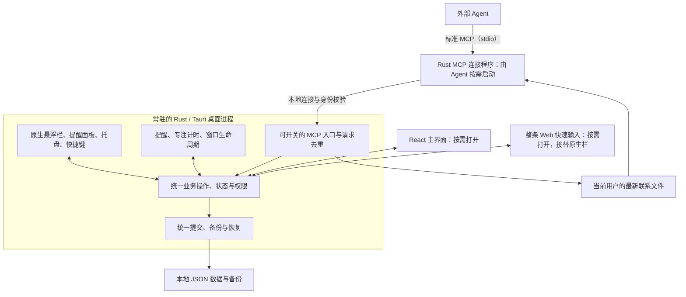
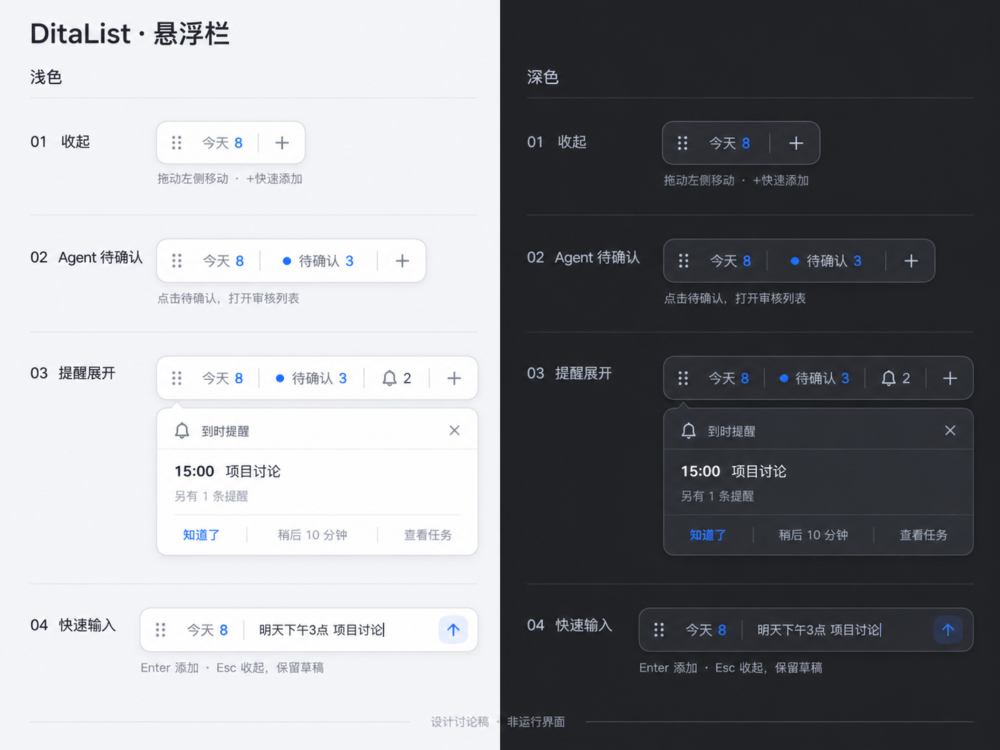

# DitaList Tauri 架构草案

日期：2026-10-30（Asia/Shanghai）
状态：已获用户授权，在独立工程 `D:\ditalist-rust` 实施；原仓库与日用版保持隔离。
文档用途：保留已确认的产品行为与架构依据。冻结功能基线和增量见 [源码来源](source-provenance.md)，共享合同见 [接口合同](interfaces.md)，实际验证结果见 [验证报告](validation.md)。
本轮实现采用 Tauri 2、Win32/Direct2D/DirectWrite、单份 schema 2 JSON、官方 rmcp stdio 桥接。提醒提示与处理分离、旧提醒失效、请求号复用、有序关闭和用户主动打开审核均是正式实现约束。

安装后交互修订：主任务页面统一由「＋」打开新增面板，Agent 待确认使用独立审核页；导航长按原位整理，左下角固定齿轮设置。详见 [2026-10-30 安装反馈](feedback-20261030.md)。悬浮栏拖柄和贴边吸附的实现记录另见 [悬浮栏专项](floating-bar-feedback.md)。

## 1. 目标与范围

DitaList 继续作为本地优先的 Windows 任务与日历软件。目标是减少完整分发成本、降低常驻资源开销，并在展开主界面时保留精美、流畅的 Web 交互。

采用一个常驻的 Rust/Tauri 桌面核心，统一管理业务数据、后台任务和桌面入口。原生悬浮栏提供轻量入口，Web 快速输入和 React 主界面按需打开。

实施仅发生在独立项目中。沿用版本 0.0.0，以源码提交和哈希标识候选；不替换日用安装，不推送远程或发布 Release。Android 不进入新工程。

## 2. 已确认的决定

| 事项 | 已确认方向 |
| --- | --- |
| 桌面框架 | 采用 Tauri，Rust 承担本地核心；保留 React/TypeScript Web 界面 |
| 平台 | 暂时限定 Windows；Android 在未来迁移中移除，本轮不删除现有文件 |
| 数据格式 | 继续 JSON，保留现有数据含义与备份兼容要求；不同时引入 SQLite 或 YAML 存储 |
| 悬浮入口 | 收起时显示原生短栏；输入时由一个按需 Web 窗口绘制整条展开栏，原生栏暂时隐藏；主界面按需打开 |
| 视觉方向 | 沿用现有产品的白色／深灰底、细边线、轻阴影和少量主题色；保持紧凑的横向布局 |
| 悬浮栏基本交互 | 今天入口查看待办，＋打开输入；待确认和提醒独立显示，左侧拖动柄用于移动 |
| 视图释放 | 快速输入收起并完成状态交接后释放；主界面进入托盘后台后默认保留 30 秒，未重开则释放，详见第 4.4 节 |
| 运行状态 | 销毁视图后后台业务与专注继续运行；真正退出程序后的恢复行为沿用当前设计 |
| MCP 开关 | 首次关闭并记住选择；关闭时停止受理新请求，已受理操作保存并保留回执后完成关闭，收尾期间显示“正在关闭”；Agent 不得自行开启 |
| MCP 连接 | 对 Agent 提供标准 MCP 接口，默认通过 stdio 连接程序接入；内部借鉴 Aether 的自动发现、实例与凭据校验、重复请求识别和统一业务规则 |
| 删除 | 普通删除移入应用内回收站；永久删除只允许本地界面操作，默认确认 |
| 确认偏好 | 回收站界面可设置“不再提醒”；只影响本地确认弹窗，不授予 MCP 永久删除权限 |
| 历史备份 | 保留历史备份；永久删除只作用于当前任务库，接受导入／恢复旧备份时可能重新出现旧任务 |
| Agent 权限 | 创建任务和修改已有任务均先确认；普通删除进入回收站，永久删除仍只允许本地操作 |
| Agent 提示 | 悬浮栏显示待审核事项数量，包含新增和修改申请；新事件合并短摘要，提醒优先；审核界面由用户主动打开，不自动弹出 |
| 安静与隐藏 | 安静时只保留数量；用户选择隐藏悬浮栏时提醒通过系统通知兜底，Agent 待确认保留托盘入口；安静模式同样约束兜底通知，输入切换导致的临时隐藏不触发兜底 |
| 提醒延后 | 默认延后 10 分钟，不改变任务截止日期 |
| 提醒补发 | 区分已提示与已处理；恢复时仅汇总补发当天真正漏发的有效未处理事件，已提示但未处理的只恢复数量；当天按实际提醒触发时间判断 |
| 提醒失效 | 完成、删除，以及影响触发条件的日期、时间、提醒设置变化，在统一入口使旧卡片、计数与延后触发失效 |
| 分发维护 | GitHub Releases 提供小体积 Setup，缺少 WebView2 时联网补装；首版手动下载新版 Setup 覆盖升级 |
| 优化目标 | 持续优化，不先编造 MB、毫秒或包体阈值；通过相同功能与数据下的测量判断收益 |

首版不安排自动更新与完整离线包。MCP 客户端的软件差异归入实现与兼容验证，不作为需要用户指定名单的产品决策。栏尺寸、窗口保留策略和原生接法已有默认选择；目前讨论范围内无需用户继续逐项选择技术参数。

## 3. 总体结构



图中原生悬浮栏、业务服务、调度和 MCP 尽量处在同一个当前用户桌面进程内。WebView2 仍可能有多个子进程。stdio 连接程序由 Agent 客户端管理，属于按需存在的接入进程。

## 4. Rust 核心的职责

### 4.1 唯一业务状态与操作入口

主界面、快速输入、原生悬浮栏和 MCP 提交具体操作，例如创建任务、修改日期、完成任务、批准 Agent 任务、移入回收站。

核心统一处理运行时校验、默认值、重复任务、导入合并、任务状态转换和权限。视图不再把整份旧数据作为任意覆盖入口。显示用的筛选、计数和查询口径由同一套业务规则提供。

核心给操作返回明确的受理、保存成功、失败或结果待核对状态。只有正式数据成功保存后，界面才显示“已保存”。向已打开的视图发送带修订信息的更新；重建视图时重新取得一致的最新状态，避免把错过事件的旧缓存当作现状。

统一业务规则也要保留入口权限差异。调用来源由宿主和接入层确定，不能相信请求参数中自行声明的“本地用户”身份。

### 4.2 保存、备份与恢复

沿用 JSON。优先兼容原有 `%APPDATA%\DidaLocal\data` 数据位置、任务 ID、日期含义、重复锚点、Agent 状态和备份导入语义。

保留串行提交、临时文件同步后替换、上一有效版本备份、损坏原件保全及退出前处理保存失败等措施。正式数据、连接凭据和视图草稿有不同生命周期，不混成同一种备份内容。

请求去重记录与业务变更必须有一致的可靠提交边界。不能仅把请求号保存在内存，也不能把两个互不关联的文件写入当成一个事务。JSON 内部快照怎样承载最小去重结果、旧版如何读取、用户备份怎样保持兼容，是后续存储设计需要证明的内容。

### 4.3 提醒与专注

提醒排程、提醒事件状态、正在进行的专注及到时通知、声音由核心管理。Web 视图仅展示状态与接收操作。

核心依据下一次有效期限安排唤醒，在任务变化、日期变化、系统恢复或时钟变化后重算。悬浮栏使用核心推送的计数和摘要，避免为了更新显示持续扫描任务库。

每次提醒分别记录“已提示”和“已处理”。已提示表示本次提醒已经在原生摘要或用户打开的提醒面板中展示，或已成功向系统提交本次通知，不代表用户已读；提示失败不能记为成功。已处理表示用户点了“知道了”；因任务变化失效的事件另记失效状态，也退出未处理提醒。点击 ×、Esc、点击外部及摘要自动收起只结束显示，不把事件记为已处理。

应用未运行或系统休眠时不执行提醒。恢复运行后，遵循以下规则，并继续服从当前安静设置：

| 事件状态 | 恢复运行后的行为 |
| --- | --- |
| 尚未提示、已经到时、本次触发日在今天，且仍有效、未处理 | 汇总进入一次补发摘要 |
| 已提示、仍有效且未处理 | 恢复提醒列表与数量，不再次自动弹出 |
| 已处理、已失效，或延后时间尚未到 | 不补发，不计入当前到时提醒数量 |
| 较早触发日的漏发事件 | 不补弹；任务仍按自身日期显示，逾期任务保留在逾期视图 |

“当天”按本次有效提醒触发时刻的本地日期判断。提前提醒使用扣除提前量后的时刻；延后提醒使用本次延后安排的时刻。例如任务截止在明天，但提前一天提醒在今天，应按今天处理；23:55 延后至次日 00:05，则按次日处理。

提醒的本次触发身份、已提示、已处理、失效状态和延后时间应持久化，并在重启后核对。单纯重绘或重建视图不生成新提醒。正在运行的专注跨视图销毁继续；专注与输入草稿跨进程退出后的恢复仍按当前行为处理，提醒补发的确认不扩大这两项能力。

任务变更正式生效时，统一业务入口同时调整提醒排程、已展开卡片、未处理计数与延后触发。完成、移入回收站或关闭提醒使对应事件失效；影响触发条件的日期、时间、提醒提前量变化，使旧提醒版本失效并按新设置重新安排。旧版本的迟到定时回调必须忽略。仅修改标题等展示字段时更新卡片内容，不因此重新提醒。Agent 修改获批后也走同一入口，批准前保持原任务与原提醒。

### 4.4 桌面与窗口生命周期

核心协调单实例、托盘、全局快捷键、原生悬浮栏、通知、窗口位置和退出清理。手动打开主界面与进入后台是不同操作。

关闭主界面进入后台时，先交接已编辑内容与必要会话状态，再按释放策略销毁视图。真正退出应用时，处理在途保存并结束后台工作。最后一个 Web 窗口销毁不应误触发整个后台退出；系统结束会话也应有独立收尾路径。

快速输入草稿保留在核心的进程内会话状态中，收起后可恢复。编辑中内容交接完成后才能销毁，不能只依赖 WebView 的卸载事件。

根据用户授权，初始生命周期策略由本草案确定如下：

- 程序进入纯后台时不预建主界面或快速输入 WebView。
- 快速输入由一个 Web 窗口绘制整条展开栏。窗口可用后接替原生栏，原生栏暂时隐藏；收起并完成草稿与在途请求交接后，按用户的显示偏好恢复原生栏并释放 Web 视图，不再设置额外的保温计时器。
- 主界面关闭／收起到托盘时先隐藏，默认保留 30 秒供短时间返回；期间停止不必要的界面动画、轮询和后台渲染。30 秒内重开则取消释放并从核心同步最新状态；超时完成交接后销毁。
- 普通最小化仍保留任务栏窗口，暂停不必要渲染；不将“最小化”擅自转换为关闭到托盘。实际关闭／收起到托盘才进入上述释放流程。
- 未交接的编辑或保存失败不能被计时器丢弃。隐藏期间若采用 WebView2 的挂起能力，也必须先完成交接；挂起属于尽力降低资源的措施，不能代替最终释放。
- 明确退出应用时不等待 30 秒，按保存与退出流程收尾。

微软建议简单初始界面使用原生组件，按实际内容需要创建 WebView，并对闲置 WebView 做资源管理。30 秒是结合本产品轻量常驻与短时间返回体验选择的初始值，不是官方规定；后续依据实际进程树与重开速度调整，不需用户预先指定性能阈值。

### 4.5 原生悬浮栏接入路线

Windows 首版选择 Rust 通过 `windows`（Rust for Windows）绑定调用 Win32 创建原生悬浮栏和提醒窗口，使用 Direct2D 绘制、DirectWrite 排字；整条 Web 快速输入和主界面由 Tauri 管理。原生栏与 Web 输入按状态切换显示，不要求把两种区域实时拼接成一个窗口。Windows 窗口细节封装在桌面入口模块，通过明确的消息与核心交换数据和操作，不承担第二套业务逻辑。

这是基于 Windows 限定与官方 Rust 示例作出的工程选择。此次查阅的 Tauri 2.12.5 `WindowBuilder` 仍要求 `unstable` feature，且并不提供完整的原生控件绘制，因此本版不依赖该裸窗口入口，也不为悬浮栏引入另一套完整 UI 运行时。

原生栏按业务状态、重绘请求、DPI 和主题变化更新，静止时不跑连续动画循环。采用 Per-Monitor V2 缩放并处理 `WM_DPICHANGED`。自动提示不抢焦点；主动操作、键盘导航、焦点反馈和 UI Automation 可访问性由原生入口模块提供。图形资源、原生消息循环与 Tauri 生命周期协调仍需实际验证；路线选择不等于已证明具体内存或延迟收益。

## 5. MCP 接入

### 5.1 开关与自动发现

首次安装默认关闭 MCP，此后记住用户选择。默认采用固定的 Rust MCP 连接程序接入，用户配置一次程序入口。连接程序在调用或重连前读取固定位置的最新联系文件。

开启 MCP 时，在本机回环地址监听可用端口，成功后再原子发布应用标识、协议版本、实例身份、实际地址及临时凭据。Agent 重连不自行打开用户已关闭的通道。

关闭 MCP 按“停止受理新请求 → 已受理操作完成保存并保留回执 → 完成关闭”的顺序执行：

1. 核心将通道置为“正在关闭”，立即拒绝新请求。受理决定与关闭门禁在核心中顺序处理；已经通过校验并纳入业务队列的请求算已受理，仅建立连接或到达接入层不算。
2. 已受理操作完成当前处理，可靠保存业务结果及可查询回执，再尽可能向原连接返回结果。创建或修改任务的这一步指保存待审核申请，不等待用户完成审批；已受理的删除按既定规则移入回收站。
3. 收尾结束后关闭监听和连接，清理本实例的联系记录，界面才显示“已关闭”。断开连接不撤销已经生效的操作；回执未送达时仍能在用户重新开启通道后用原请求号查询，本地核心保留对应状态。

保存或回执持久化失败时保留未完成状态并明确提示，不能静默丢弃请求或伪报正常关闭；新请求仍保持拒绝。整个应用退出时复用数据保存与退出收尾规则。通道关闭不清除已经保存的待确认申请。

联系文件只供当前用户访问，临时凭据不进入公开配置、普通日志、任务备份或 GitHub 分发包。只有本实例拥有的联系记录可以由本实例清理。

对外按标准 MCP 提供工具发现、参数定义、调用与结果，首版默认使用通用 stdio 接入。Aether 式联系文件、动态端口和实例校验封装在连接程序与 Rust 核心之间；Agent 按标准协议调用，连接程序负责寻找 DitaList。内部本地通信地址不自动等于可供任意客户端直连的标准 MCP HTTP 地址。

支持相同协议版本、工具能力和 stdio 接入方式的客户端，应可复用同一连接程序及工具定义。各软件的配置入口、启动命令格式、协议版本及可选能力可能不同，由实现阶段处理配置说明与兼容验证，不再要求用户先选一份软件名单。

MCP 也定义了 Streamable HTTP 接入方式。只接受服务网址、不能启动本机程序的客户端不能直接使用 stdio 入口，也不能自动读取本机联系文件；此类差异保留为后续兼容扩展条件，不影响当前本地通用接入架构。云端服务访问用户电脑属于另一个部署需求，本草案不因此加入公网服务。端口继续主要作为高级配置与诊断信息。

### 5.2 身份与请求去重

连接层核对应用、协议、实例和连接凭据。每次启动或重新启用通道时更新连接身份，减少旧连接继续使用的情况。

MCP 写工具将业务 `requestId` 明确列入必填参数。调用方（Agent 或其宿主）在首次发起一项业务操作时生成并保留该号；同一操作的工具重试、连接重试和结果查询均复用。连接程序原样传递，不能每收到一次 MCP 调用就重新生成一个号，也不能用 JSON-RPC 消息 `id` 代替业务号。两者用途不同：消息 `id` 对应一次请求与回复，业务号识别跨调用重试的同一项操作。

核心核对业务号、操作类型与规范化参数指纹，回执包含该业务号及明确的结果状态。只读查询不要求为每次查询创建新的业务号；查询某次操作结果时使用它原来的业务号。本地界面写操作如需重试，同样由首次提交入口生成并在在途状态中保留操作标识。

去重规则如下：

- 同一编号、相同操作和参数：返回已经记录的结果，不再执行一次。
- 同一编号却改变操作或参数：返回冲突。
- 原请求仍在进行：查询或等待原请求，不创建第二次操作。
- 断连、超时或重启后结果不明确：查询原请求，不换编号盲目重跑。
- 两次有意创建的相同标题任务应使用不同编号，不能仅凭标题判断重复。

调用方为重复意图提供了新的业务号时，核心无法仅凭标题或相似内容可靠判断是重试还是第二项真实操作；不承诺识别这类重复意图。工具参数说明与错误提示应明确要求保留原号，通用 MCP 协议本身不自动提供业务去重。

连接实例换新不意味着业务请求变成新请求。去重记录需要跨重启可核对，并有明确的保留与回收策略；超出可核对范围的旧写请求不能假装具备无限期去重保证。

### 5.3 Agent 权限

创建 Agent 任务继续进入待确认状态。批准前不触发正式任务提醒，也不混入已确认的今天待办数。

MCP 删除只移入回收站。永久删除、清空回收站及其本地确认能力不暴露给 MCP；“不再提醒”偏好不会改变这条权限边界。

Agent 修改已有任务先产生“修改申请”，本地用户批准后再生效。申请独立保存目标任务、待改字段和提交时的基准版本；原任务在批准前继续按已有内容、日期与提醒运行，不应因为有修改申请就从今天待办中消失。

审核界面区分“新增任务”和“修改任务”，修改展示变更前后的差异。用户在等待期间改动了目标任务时，批准前重新核对并明确冲突，不能把旧建议整份覆盖到新状态。目标任务已删除时也不能借批准修改而隐式恢复。

MCP 对创建和修改返回待确认状态与可查询的申请标识，不能把“申请已保存”描述成“任务修改已生效”。重复请求复用同一申请；批准和拒绝由本地用户界面完成。待确认数量按待审核事项计数，包含新增申请与修改申请。

MCP 开关状态与已有待确认事项是两回事：关闭通道后，已存在的申请继续保留并可由用户审核。上述权限是架构决定，当前产品尚未因此改变行为。

## 6. 回收站与分发

### 6.1 应用内回收站

普通删除保留任务内容并标记为已删除，可从回收站恢复。它是应用内的数据状态，不需要把整个数据库文件搬到 Windows 回收站。

永久删除从当前正式任务库移除记录，默认由本地界面确认；用户可在回收站界面设置不再提醒。用户已确认保留历史备份，永久删除不联动改写或清除这些文件；当前库移除不代表全部副本擦除。

以用户手动导出的文件为例：周一备份中有任务 A，周二从当前库永久删除 A，周三再导入周一的文件，文件里仍然保存着 A。本次只读核对的 `importBackupText` 按 ID 合并，保留本机已有任务、补入本机缺少的任务，所以 A 的 ID 已从当前库移除时可能被重新加入。普通移入回收站仍保留该 ID，按现有合并规则会保留本机的回收站状态。

因此“旧备份可能让任务回来”指主动导入，或者数据损坏、缺失后恢复到了含有该任务的旧版本；正常读取有效当前库不会仅因旁边存在备份就导入旧任务。用户已接受这一行为。历史文件保留原样，导入／恢复时说明范围，不为阻止旧任务恢复新增特殊拦截规则。程序维护的自动备份继续按既有策略轮换，与用户独立导出的历史文件区分。

### 6.2 GitHub 与覆盖安装

GitHub Releases 可提供版本说明与 Setup。手动升级流程为：下载新版安装包，退出托盘程序，运行安装向导，沿用安装目录升级。

建议研究继续用 Inno Setup 封装 Tauri 产物，保持既有安装身份、用户安装范围、快捷方式及独立数据目录。首次 Electron 到 Tauri 的迁移需验证旧程序文件、安装记录、数据读取和 MCP 入口衔接。

用户已确认优先分发小体积 Setup；检测到缺少 WebView2 时联网补装，下载或安装失败时明确提示可重试。首版通过 GitHub Releases 手动下载 Setup 覆盖升级，不安排自动更新或完整离线包。GitHub 发包本身不等于应用已具备检查或安装更新能力。

## 7. 现有代码的去留

以下映射以最初指定的 DitaList 提交 `c925440b9ff00c5d1cf41e265d811c84a532e15e` 为源码研究基线。其他对话后续完成的日历视觉成果属于可复用界面资产；本草案不覆盖或接管其改动。

| 现有部分 | 草案中的去向 |
| --- | --- |
| React 日历、任务列表、详情、设置、CSS、图标 | 主要保留；读取、提交和订阅方式改为核心服务接口 |
| `src/App.tsx` 中的数据修改、保存、提醒 | 权威业务迁入 Rust；React 保留页面、表单与显示状态 |
| `src/App.tsx` 中检测待确认任务后自动打开审核弹窗的逻辑 | 迁移时移除自动弹窗 effect 及其视图内“已经看过”门禁；核心事件只更新数量与摘要，审核由用户点击入口打开，主界面重建也不自动弹出 |
| `src/components/Tools.tsx` 中的专注 | 保留视觉交互；运行状态、到时处理及记录提交迁入核心 |
| `src/core/domain.ts` | 规则、样例和行为断言作为迁移依据；权威校验、完成、重复生成和导入合并迁入 Rust |
| `src/model.ts` | 保留数据语义，跨语言类型与合同从统一来源维护 |
| `src/core/storage.ts`、`electron/preload.cjs` | 桌面分支替换为 Tauri 命令与事件适配；不保留第二个正式数据写入者 |
| `src/FloatingApp.tsx`、`src/floating.css` | 常驻入口重做为原生悬浮栏；文本编辑、伸展与输入法处理用于整条 Web 展开栏，沿用现有视觉语言，按第 8 节与原生栏切换显示 |
| `electron/main.cjs` | 宿主实现迁入 Rust，保留数据保护与生命周期合同 |
| `mcp/server.mjs` | 替换为 Rust MCP 连接程序及核心接入层，尽量保持工具语义兼容 |
| Electron 打包脚本 | 替换运行时载荷组装；安装身份、数据保留和产物追溯要求继续保留 |
| `android-native` 及 Android 构建、文档入口 | 不进入本次 Windows 架构；未来迁移时处理删除，本轮不动 |

自动审核弹窗这一补充项在审查基线 `be30dac7cc4317e5dd67eca03312d8fa2ffaa07c` 中确认：`reviewedAgentIds` 只在当前视图存活，相关 effect 会在发现未记录的待确认任务时打开弹窗。移除此行为是迁移要求，本轮没有修改该源码。

## 8. 悬浮栏设计与交互

用户已认可悬浮栏方向及本节的合并摘要、安静与隐藏、提醒延后和补发策略。视觉稿作为设计基线，示意数字均为虚构，不代表已经实现或测量。新增的修改审核也计入待确认入口，图中“待确认 3”可由新增与修改申请共同组成。

### 8.1 视觉基线与四种状态



采用一条连续的紧凑圆角栏。沿用现有产品的白色／深灰表面、细边线、轻阴影、常规字重与线条图标；数量和操作仅使用少量当前主题色。各入口放在同一条栏内，分隔线区分点击区域。

浅色参考现有悬浮组件的 `#ffffff` 表面、`#333741` 文字和 `#dfe1e7` 边线；深色参考 `#292b30` 表面、`#e7e8ec` 文字和 `#454850` 边线。示意蓝色为现有默认主题色 `#4772fa`，实际随用户的主题色设置变化。字体沿用 Microsoft YaHei UI / Segoe UI。

```text
收起：        [ 拖动柄 | 今天 8 | ＋ ]
Agent 待确认：[ 拖动柄 | 今天 8 | 待确认 3 | ＋ ]
有提醒：      [ 拖动柄 | 今天 8 | 待确认 3 | 铃 2 | ＋ ]
提醒展开：    [ 同一条悬浮栏                         ]
              [ 到时提醒                         × ]
              [ 15:00 项目讨论 · 另有 1 条提醒       ]
              [ 知道了 | 稍后 10 分钟 | 查看任务     ]
快速输入：    [ 拖动柄 | 今天 8 | 明天下午3点 项目讨论 | ↑ ]
```

待确认和铃铛入口各自在数量非零时出现；两者均为零时回到最短的「今天 8 ＋」。没有今天待办时显示「今天 0」，其他有效入口继续保留。三种数量分别表示不同信息，不相加。

依据用户委托，并参考 Windows 点击目标和浮层几何规范，初始参数确定如下。单位为逻辑像素（DIP），会随系统缩放换算为屏幕像素；视觉稿经过放大，不用图片中的像素反推尺寸。

| 参数 | 初始默认 |
| --- | --- |
| 栏高、最短栏宽 | 40 × 180 DIP；宽度随待确认、提醒和长数字增长 |
| 主要按钮与拖动柄命中范围 | 至少 40 × 40 DIP，文字入口可以更宽；小图标本身不代表整个点击范围 |
| 栏与提醒面板圆角 | 8 DIP；内部按钮圆角 4 DIP |
| 正文字号、图标尺寸 | 14 DIP、16 DIP；系统文字放大时允许整体重新布局 |
| 栏与面板间距 | 8 DIP，展开方向根据工作区可用空间调整 |
| 快速输入初始宽度 | 420 DIP，按内容增长至 560 DIP 后换行；窄工作区内自适应 |
| 提醒面板初始宽度 | 320 DIP，长标题换行、按钮不截断 |

Windows 官方给出了约 40×40 的点击／触控目标参考和顶层浮层 8px 的圆角层级；具体栏宽、输入宽度等为本产品选择，并非统一强制标准。文本放大、主题、DPI 与实际命中验证若发现问题，可调整这些初始值，无需用户逐个指定像素。

提醒面板沿栏边对齐展开，快速输入沿同一横向布局延伸。组件以用户放置的位置为锚点，新增内容向屏幕工作区内侧展开。输入态保留「今天」入口，待确认和提醒暂退回后台状态，收起后恢复最新数量；新消息不挤占编辑区域。

### 8.2 三种数量的口径

| 信息 | 本版口径 | 状态含义 |
| --- | --- | --- |
| 今天待办数 | 已确认、未完成、未删除，属于核心“今天（含逾期）”筛选的任务数 | Agent 待确认不混入；与主界面共用查询规则 |
| Agent 待确认数 | 尚待用户审核且仍有效的新增任务申请与修改申请数量 | 同一请求重试不重复计数；看过不等于批准；关闭 MCP 不清掉该数；原任务已有的今天计数不因修改申请改变 |
| 提醒数 | 已到时且尚未明确处理的有效提醒事件数 | 已提示但未处理的仍计数；同一任务可以同时属于待办和提醒，逾期本身不自动增加提醒数 |

较大数字可显示 `99+`，原生提示说明中给出完整值。文字、图标和数量共同表达状态；颜色仅作为辅助。只查看提醒或审核列表，不减少对应数量。

### 8.3 点击、展开与收起

| 用户操作 | 具体行为 |
| --- | --- |
| 点击「今天 8」区域 | 按需打开或聚焦主界面“今天”视图 |
| 点击「＋」 | 按需打开绘制整条展开栏的 Web 窗口，可用后暂时隐藏原生栏；恢复本次进程内草稿并聚焦输入 |
| 再次通过快捷键等方式唤起已打开的输入 | 聚焦原输入，保留草稿与在途提交状态 |
| 点击「待确认 3」 | 打开或聚焦现有主界面的审核列表；仅查看，不自动批准 |
| 点击铃铛数量 | 展开原生提醒面板；已展开时再次点击只收起面板 |
| 点击提醒面板的「查看任务」 | 按需打开主界面并定位这条任务，不自动完成或确认提醒 |
| 提醒面板的 ×、Esc、点击外部 | 收起面板，未处理的提醒数量继续保留 |
| 输入中的 Enter 或提交箭头 ↑ | 提交当前内容；中文组合输入期间按第 8.6 节处理 |
| 输入中的 Esc 或真正点击外部 | 交接草稿后收起，按用户显示偏好恢复原生短栏；不提交内容 |
| 拖动左侧拖动柄 | 越过平台拖动阈值后移动整条栏；本次手势不触发导航或提交 |
| 拖到屏幕工作区边缘后松手 | 16 DIP 内吸附并收成 4 DIP 白色细线；上下边为短横线，左右边为短竖线 |
| 鼠标移入边缘细线／移出悬浮栏 | 移入即展开原生栏，不抢焦点；移出约 500ms 后收回，栏内按钮之间移动不收回 |
| 展开后拖离边缘 | 恢复完整悬浮栏，不再自动收起；输入／提醒／拖动操作期间不收成细线 |
| 悬停原生栏某一入口 | 显示简短原生说明，不抢焦点、不创建 WebView |
| 右键 | 原生菜单提供主界面、今天、待确认、提醒、显示/隐藏悬浮栏、MCP 开关与退出入口 |

提交箭头在输入态接替「＋」的位置，含义明确为提交。拖动柄与业务按钮分开，避免拖动被当作点击。主要动作不依赖双击、长按或悬停；全局快捷键、键盘导航与托盘保留对应入口。

同一时刻只展开一个悬浮输入或提醒面板。用户主动切换到主界面、提醒或拖动时，先完成输入法收尾并交接草稿，再收起当前输入。后台事件不切换面板，也不把用户正在点击的任务替换成另一条。

主界面可以与悬浮栏同时存在。屏幕边缘、显示器拔插或 DPI 变化后，栏与面板保持在可见工作区中。数量变化不应在一次点击或拖动手势中移动操作目标。

贴边是自动隐藏交互：收起时只保留白色细线，完整栏的位置与尺寸另行保存，不以细线矩形替代快速输入的锚点。展开栏保留 8 DIP 圆角，细线两端圆润；竖线居中避开圆角空区，移入后不会出现悬停断层。按当前显示器缩放，角落选择单一细线方向。收展采用临界阻尼弹簧，容器、圆角、背景和内容同步变化，文字与图标等比缩放；中途反向保留当前位置与速度。过渡时使用临时原生 alpha 画布，结束后恢复标准按钮并释放画布、取消计时。系统关闭界面动画时直接切换。自动摘要依原提醒规则临时展开，结束后回到细线；静止时没有动画循环或 WebView。

点击悬浮栏打开主界面时，冷启动、隐藏缓存和最小化恢复共用水滴式展开：圆润前端先舒展，弯曲的窄尾连接源栏，再铺开为圆角主窗，视觉过程约 820ms。真实 App 保持目标布局尺寸，文字等比缩放；曲线路径只改变外轮廓。透明主 WebView 画布覆盖起止区域，原生窗口只在起止调整尺寸。主窗局部禁用 DWM 系统过渡；先在源栏范围绘制新首帧，确认后再解除裁剪并交接，避免缓存旧整窗先出现。冷启动在界面外壳就绪后即可开始，数据加载并行进行；仍需等待 WebView2 创建，不承诺冷启动零延迟。已显示主窗只切换和聚焦。非最大化的隐藏主窗可跟随栏所在屏幕，跨屏且已最大化时保留原位置普通显示。减少动画、失败、取消及超时均能结束交接、恢复入口；主界面关闭后的 30 秒释放规则保持。具体实现与验收边界见[水滴式展开记录](motion-flow-20261030.md)。

### 8.4 新事件怎样提示

用户已确认合并短摘要、提醒优先，以及安静与隐藏的处理。默认行为如下：

- 新到时提醒在栏边自动展开原生摘要，默认约 5 秒后收回；Agent 新申请也合并为一条摘要。提醒优先，不同时堆叠两套浮层。
- 多条 Agent 申请合并为“新增 3 条待确认”；审核列表内区分新增与修改。多个提醒合并数量并显示一条摘要，不连续轮播。
- 自动摘要不抢键盘焦点，不打开 WebView。用户悬停、聚焦或开始操作后暂停自动收回；手动打开的提醒面板由用户收起。
- 仅今天数量变化时不主动展开。正在输入、拖动或处理一条提醒时，新事件只更新后台状态与可见数量，不打断当前操作。
- 自动摘要显示成功后记录“已提示”，消失后未处理事件继续保留入口。重绘、重建视图、重新打开主界面或重启，不让已提示的同一次提醒再次自动弹出；真正漏发的按第 4.3 节补发。
- 新申请、主界面加载或视图重建均不自动打开审核弹窗。用户点击待确认入口后才打开审核界面，点击「今天」仍进入今天视图。
- 安静模式停止主动展开和声音，保留数字及手动查看入口；复用通知设置，具体入口随界面细化。
- 用户选择隐藏悬浮栏时，到时提醒通过系统通知兜底，Agent 待确认保留托盘入口；不因新事件强制显示悬浮栏。安静模式同时约束这条兜底路径，避免换一个入口继续打扰。输入时暂时隐藏原生栏属于窗口切换，不改变显示偏好，也不触发这条兜底路径；输入期间仍按不打断规则处理。

### 8.5 提醒的三个动作

| 动作 | 对提醒的作用 | 对任务的作用 |
| --- | --- | --- |
| 知道了 | 结束本次提醒，数量减少 | 不改变完成状态 |
| 稍后提醒 | 本次提醒进入延后状态，默认 10 分钟后再出现；首版保留一键操作 | 不改变任务截止日期 |
| 查看任务 | 打开对应任务，提醒保留到明确处理或失效 | 不自动完成任务 |

×、Esc、外部点击只收起显示，不等于“知道了”。完成、移入回收站或关闭提醒使对应事件失效；影响触发条件的日期、时间或提醒提前量变化，使旧提醒版本及旧延后安排失效。统一业务入口同步更新排程、展开卡片、提醒数与延后事件，迟到的旧版本回调不再提示。

延后时从当前到时提醒数中移除，核心记录下一次触发时间及其尚未提示状态，到时再进入提醒数。再次延后替换旧安排，旧定时触发不得重复出现。提醒身份包含任务、提醒版本与本次有效触发时点；“当天”按扣除提前量或延后后的触发时刻判断，不直接使用任务截止日期。

多条提醒逐条处理时稳定保留当前任务身份。Agent 新建待确认任务不进入正式提醒队列；已有任务的待审核修改不改变原提醒，获批后按统一任务变更规则更新。休眠恢复或重新运行后按第 4.3 节只汇总补发当天真正漏发、仍有效且未处理的事件；已提示但未处理的恢复数量与列表，不重新弹出。

### 8.6 Web 快速输入

- 沿用紧凑横向输入条：左侧保留今天入口，中间文本，右侧提交箭头。初始使用单行高度，内容较长时按需伸展。
- 打开时恢复本次进程内草稿。收起后保留在核心会话状态中；真正退出程序后的草稿行为沿用当前设计。
- 非组合输入时，Enter 提交，Shift+Enter 换行；中文组合期间的 Enter、Esc 优先交给输入法。
- Esc、真正点击窗口外部或导航离开时，先将草稿交接给核心再收起释放。输入法候选窗口和本应用菜单不能被误判成普通外部点击。
- 默认清单沿用现有业务设置，主条不常驻多排清单与日期控件。输入解析出的日期、清单以及错误，可在需要时展示紧凑辅助行；具体文字密度留待验证。
- 提交中显示保存状态并抑制重复提交。用户可以先收起，核心继续处理；必要时暂缓销毁 Web 视图直到完成回执交接。
- 成功且已落盘后才清除对应提交的草稿；失败保留原文与错误；结果不明确时查询原请求号。重新打开输入不能把在途请求变成第二次创建。
- 收起、查看提示和编辑草稿均不改变 Agent 批准状态，也不完成任何任务。

视觉上保持同一条栏，窗口采用整体切换：收起时显示原生栏；用户打开输入后，单个按需创建的 Web 窗口绘制拖动柄、今天入口、输入框、提交箭头及辅助行，原生栏暂时隐藏。无需把原生区域与 Web 区域实时拼接，也无需让两个窗口同时接收同一条栏的输入。

核心提供当前锚点、主题、数量、草稿和在途提交状态。Web 窗口可用后再切换，创建失败时保留原入口并显示失败信息；收起时先交接草稿与请求状态，再按用户显示偏好恢复原生栏并释放 Web 视图。暂时隐藏不改写用户的悬浮栏开关；不为避免窗口切换而常驻隐藏 WebView。文字、边线、缩放与焦点切换的一致性仍需实际验证。

### 8.7 常驻轻量约束

纯后台且主界面已按第 4.4 节释放后，收起态只需要 Rust 核心与原生窗口。栏、计数、简单按钮、原生提醒面板按事件更新；静止时不持续动画，不为显示数量维持 WebView，也不重复轮询完整任务库。

详细任务与 Agent 审核复用主界面。快速输入仅在用户主动操作后创建，收起后按释放策略关闭。形状从圆球改为短栏，不改变业务常驻、复杂界面按需加载的分工。

多屏 DPI、中文输入、键盘导航、浅深主题、焦点恢复、保存失败及 WebView 释放以后用实际生产组件验证。本轮视觉稿属于设计参考，不能作为运行或性能证据。

## 9. 决策状态与后续验证

### 9.1 本轮已确认与已委托确定

| 原编号／事项 | 当前结论 |
| --- | --- |
| D1：Agent 修改权限 | 用户确认先审核；申请获批前原任务照常运行 |
| D2：新消息提示 | 用户确认合并短摘要、提醒优先；安静时只留数量，用户隐藏悬浮栏时提醒用系统通知兜底、Agent 保留托盘入口；移除旧审核自动弹窗，审核只由用户主动打开 |
| D3：漏过提醒补发 | 用户确认区分已提示与已处理；只补发当天真正漏发、仍有效且未处理的事件，已提示的只恢复数量；当天按有效触发时刻判断 |
| D4：延后提醒 | 用户确认默认 10 分钟；首版采用一键操作，不另加多档选择 |
| 提醒变更清理 | 用户确认日期、时间、提醒设置变化后统一更新排程、卡片、计数与延后事件，旧版本失效 |
| D5：MCP 默认状态与关闭 | 用户确认首次关闭、记住选择；Agent 不得自行开启；关闭先停止受理，再保存已受理结果及回执，收尾期间显示“正在关闭” |
| D6：MCP 通用兼容 | 按标准 MCP 实现，以 stdio 为默认本地入口；客户端差异归入工程兼容验证，无需用户指定软件名单 |
| MCP 业务请求号 | 用户确认写工具必填，由调用方首次生成并在同一操作重试时复用；连接程序透传，不用 JSON-RPC 消息 id 替代 |
| D7：WebView2 与包体 | 用户确认小安装包、缺失时联网补装；首版不安排完整离线包 |
| D8：升级方式 | 用户确认首版手动下载 GitHub Releases 的 Setup 覆盖升级 |
| D9：永久删除与历史备份 | 用户接受旧备份导入／恢复时可能带回已永久删除任务；历史文件保留原样，不联动清理 |
| 栏尺寸 | 用户委托按主流设计选择；初始值见第 8.1 节，后续以验证调整 |
| 主界面保留时长 | 用户委托选择；关闭到托盘后默认保留 30 秒，快速输入交接后释放 |
| 原生接入与输入切换 | 原生栏用 Win32 + Direct2D / DirectWrite，Tauri 管理按需 Web 窗口；用户确认输入时由单个 Web 窗口绘制整条展开栏并接替原生栏，收起后切回 |

这些产品决定已纳入独立工程实施授权。此前已确认的 Tauri、Windows、JSON、悬浮栏、回收站与 MCP 权限边界保持。

### 9.2 架构讨论状态

在目前讨论范围内，主要产品行为与架构方向已形成完整基线，没有需要用户继续拍板的已知大项。MCP 软件兼容不再列为产品决策，后续按标准协议和实际连接验证处理。

这里的“已定”表示产品与架构基线已经确认，不表示每个运行环境均已验证。工程验证结果单独记录；新增需求或影响产品取舍的问题才重新讨论。

### 9.3 后续技术验证，不需要用户再选择底层参数

| 验证项目 | 当前默认与需要获得的证据 |
| --- | --- |
| 栏与面板 | 从 40 DIP 栏高、180 DIP 短栏、8 DIP 圆角开始；核对长文字、99+、空状态、命中范围、键盘可访问性、浅深主题及文字缩放 |
| 窗口保留 | 验证 30 秒短暂保留与快速输入及时释放的实际重开体验、资源占用和状态完整性，再据此调整 |
| 原生窗口 | 验证 Win32 消息与 Tauri 生命周期协调、Direct2D / DirectWrite 资源释放、焦点和 Per-Monitor V2 缩放 |
| 原生栏与整条 Web 输入切换 | 验证两种状态互斥显示、创建失败时原入口可用，以及输入法候选窗、缩放、锚点、边线、焦点和草稿交接；临时隐藏不改写用户偏好或误触发系统通知 |
| WebView 释放 | 查看完整进程树，区分视图销毁、共享浏览器进程和实际内存变化，不承诺全部子进程立即退出 |
| MCP 协议兼容 | 按所选 SDK 的协议版本核对 stdio、工具发现、参数 Schema、调用结果与错误行为；由工程侧选择代表性客户端验证配置和连接，不把单个客户端通过等同于全部版本通过 |
| MCP 重试与关闭 | 验证调用方复用业务号、并发重试、丢失回执后查询、同号不同参数冲突；关闭与受理顺序明确，已受理请求保存后关闭，持久化失败可见，保存待审核申请不等待人工审批 |
| Agent 修改审核 | 验证变更差异、原任务保持有效、重复申请去重、审批时版本冲突与目标删除，以及返回的待确认／生效状态 |
| 审核入口迁移 | 有待确认申请时首次打开或销毁后重建主界面，点击「今天」仍进入今天；仅点击审核入口才打开审核界面 |
| 提醒状态与变更 | 验证已提示但未处理的事件经收起与重启后只恢复数量，真正漏发的才补摘要；覆盖改期、关闭提醒、取消旧延后、迟到回调、提前提醒与跨午夜延后 |
| 数据与去重持久化 | 验证原格式兼容、业务变化与请求回执一致提交、结果核对及去重记录保留边界；提醒身份、版本、已提示、已处理、失效及延后状态可跨重启核对 |
| 旧安装迁移 | 验证安装身份、旧运行时文件处理、独立数据目录、旧 MCP 配置和新连接入口的衔接 |

这些项目构成实施验收清单；已运行、仅源码覆盖和环境暂未覆盖项分别记录在验证报告中。

## 10. 依据与证据边界

业务架构研究以指定 DitaList 基线和 Aether 控制层参考代码为依据。视觉修订额外只读查看了现有样式和已保存的界面截图；样式核对时 DitaList HEAD 为 `be30dac7cc4317e5dd67eca03312d8fa2ffaa07c`。这不改变第 7 节的业务代码研究基线，也不把其他对话的改动归入本任务。

此前为解释旧备份，在 `be30dac7cc4317e5dd67eca03312d8fa2ffaa07c` 只读核对了 [备份导入合并](D:/dida-local/src/core/domain.ts:667) 和 [自动备份恢复](D:/dida-local/electron/main.cjs:126)，确认按 ID 补入缺失任务、保留已有任务，以及故障时读取备份的分支；没有实际导入或恢复数据。

历史审查以 `be30dac7cc4317e5dd67eca03312d8fa2ffaa07c` 核对了旧版自动审核弹窗、Electron MCP 请求队列、创建工具参数和整条 Web 输入。这些证据用于确认迁移对象；本次独立工程的实际来源提交见 `source-provenance.md`，实现与验收进度以 `function-matrix.md` 和 `validation.md` 为准。

本对话没有为该架构运行产品、连接 MCP 服务、构建安装、执行设备操作或打开用户任务数据库。文件改动限定在仓库外 Markdown 与此前选定的配套视觉稿；生成的图片不是生产组件截图。

- DitaList：`c925440b9ff00c5d1cf41e265d811c84a532e15e`。[业务规则](D:/dida-local/src/core/domain.ts)、[前端与保存](D:/dida-local/src/App.tsx)、[专注](D:/dida-local/src/components/Tools.tsx)、[宿主与 MCP](D:/dida-local/electron/main.cjs)、[现有悬浮输入](D:/dida-local/src/FloatingApp.tsx)、[安装定义](D:/dida-local/scripts/installer/DitaList.iss)。本地文件链接可能随主线演进，本文事实基线以上述提交为准。
- 视觉参考：[现有悬浮样式](D:/dida-local/src/floating.css)、[主界面样式](D:/dida-local/src/styles.css)、[已有浅色悬浮组件预览](D:/dida-local/reports/appearance-floating-toggle/20261029-220712/floating-design-preview.png)、[已有深色输入预览](D:/dida-local/reports/appearance-floating-toggle/20261029-220712/floating-dark-preview.png)、[已保存的日历界面参考](D:/dida-local/reports/calendar-interactions/20261030-103854/user-calendar-drag.png)。第 8 节配图沿用这些样式，布局为本对话提出的悬浮栏设计。
- Aether：控制层核对基线 `aff1b58aa69e1347bc4f4a5ad5eaf41b93d76d81`。[地址发布与身份校验](D:/Work/aether/src/main/control/server.ts)、[请求记录与去重](D:/Work/aether/src/main/control/controller.ts)、[连接程序](D:/Work/aether/scripts/aether-control-mcp.mjs)。借鉴机制不等于复制 Aether 的全部业务框架。
- [Tauri 窗口延迟创建配置](https://v2.tauri.app/reference/config/#windowconfig)、[裸窗口构建 API](https://docs.rs/tauri/latest/tauri/window/struct.WindowBuilder.html)、[权限边界](https://v2.tauri.app/security/capabilities/)。
- [微软 WebView2 关闭与资源说明](https://learn.microsoft.com/en-us/microsoft-edge/webview2/reference/win32/icorewebview2controller#close)、[进程模型](https://learn.microsoft.com/en-us/microsoft-edge/webview2/concepts/process-model)。
- 本轮窗口与绘制路线依据：[WebView2 性能最佳实践](https://learn.microsoft.com/en-us/microsoft-edge/webview2/concepts/performance)、[微软 Rust for Windows 的 Direct2D 示例](https://github.com/microsoft/windows-rs/blob/master/crates/samples/windows/direct2d/src/main.rs)、[Windows 高 DPI 与 Per-Monitor V2](https://learn.microsoft.com/en-us/windows/win32/hidpi/high-dpi-desktop-application-development-on-windows)。官方文档支持原生初始界面、按需创建和闲置资源管理；30 秒保留期为本产品初始策略，不是文档规定。
- 本轮尺寸依据：[Windows 点击／触控目标](https://learn.microsoft.com/en-us/windows/apps/develop/input/guidelines-for-targeting)、[Windows 几何与圆角](https://learn.microsoft.com/en-us/windows/apps/design/signature-experiences/geometry)。参考官方原则后确定本产品尺寸，不宣称整个悬浮栏布局是系统规定。
- 客户端术语与接入区别：[MCP 架构概览](https://modelcontextprotocol.io/docs/learn/architecture)、[MCP SDK 的本地进程和 HTTP 连接](https://ts.sdk.modelcontextprotocol.io/v2/clients/connect)。这些支持接入方式说明，不代替具体客户端版本验收。
- 请求标识区别：[MCP 官方 SDK 的 JSON-RPC 消息 id 说明](https://csharp.sdk.modelcontextprotocol.io/api/ModelContextProtocol.Protocol.JsonRpcMessageWithId.html)。消息 id 用于请求与回复对应；本文的业务请求号及跨重试去重是应用层合同。
- 交互参考：[Windows 通知设计](https://learn.microsoft.com/en-us/windows/apps/develop/notifications/app-notifications/app-notifications-ux-guidance)、[轻量浮层的收起行为](https://learn.microsoft.com/en-us/windows/apps/develop/ui/controls/dialogs-and-flyouts/flyouts)。这些是交互参考，不表示本方案必须采用 WinUI 控件。
- [JSON 标准](https://www.rfc-editor.org/rfc/rfc8259.txt)、[GitHub Releases](https://docs.github.com/en/repositories/releasing-projects-on-github/about-releases)、[Inno Setup 安装身份](https://jrsoftware.org/ishelp/topic_setup_appid.htm)、[沿用安装目录](https://jrsoftware.org/ishelp/topic_setup_usepreviousappdir.htm)、[Tauri Windows 安装器](https://v2.tauri.app/distribute/windows-installer/)。
